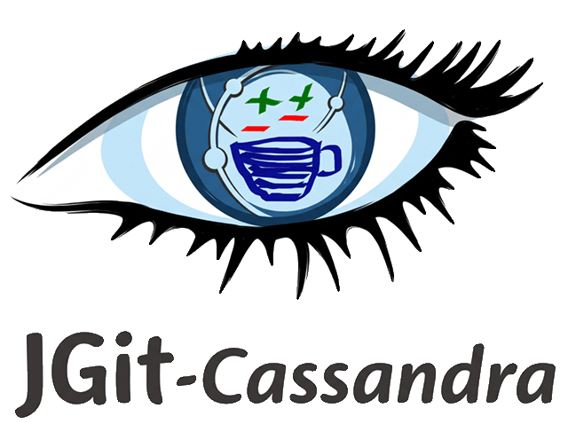

<<<<<<< PATCH SET (ef75fd511b21472eb3d1171590c72ba34b3a7855 WIP - add basic cassandra unit test.)
### JGIT - Cassandra
JGit with Apache Cassandra database as storage backend. 
  
Have an instance of Cassandra running or use ccm Cassandra Cluster 
Manager https://github.com/pcmanus/ccm.

Create one cassandra instance with latest version 
`ccm create jgit -v 3.0.9`
populate 1 instance `ccm populate -n 1`
start instance `ccm start`

To access cqlsh via `ccm node1 cqlsh`

=======
# JGit / Cassandra

## Overview

JGit/Cassandra is a storage backend extension for the [Eclipse JGit](https://eclipse.dev/jgit/)
project. The primary aim of this project is to implement a JGit `DfsObjectDatabase` (Distributed
File System Object Database) on top of **Apache Cassandra**.

By leveraging Cassandra's highly scalable, distributed NoSQL architecture, this project allows Git
repositories to be distributed and replicated seamlessly across multiple nodes and datacenters,
providing high availability and massive scalability for Git object storage.

## Features (Target)

* Implementation of JGit's `DfsRepository` and `DfsObjectDatabase` interfaces.

* Horizontally scalable Git object storage.

* Native Cassandra replication for high availability and disaster recovery.

## Getting Started

*(Instructions for building the project with Maven/Gradle, configuring the Cassandra connection
points, and integrating the DfsRepository into a JGit application will be added here as the
implementation progresses.)*

## Authors and Maintainers

This project was initially created and is currently maintained by:

* **Haithem Jarraya**

* **Luca Milanesio**

We welcome community contributions, architectural discussions, and feedback from other developers
working within the Git and Cassandra ecosystems.

## License

This project is licensed under the **Business Source License (BSL) 1.1**.

Please refer to the [`LICENSE`](LICENSE) file in the root of this repository for the full license text and
specific terms regarding usage and eventual conversion to an open-source license.
>>>>>>> BASE      (8a2e791dba95cf43d65ccc319195256257dbafae Initial README, LICENSE and project skeleton)
